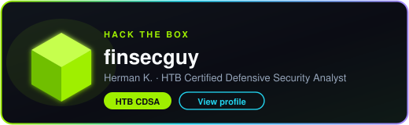

<!-- Profile README for github.com/finsecguy (repo finsecguy/finsecguy). -->

  

  

**GRC &amp; Compliance Automation** · Bratislava, Slovakia

<em>Compliance and security automation for finance</em>

 

<!-- Contact badges. -->

  
  
  
  
  
  

  

  <h2>Identity, with signal</h2>

<em>Automate the checks. Never the judgment.</em>

**Focus:** `Python` · `Flask` · `FastAPI` · `SQLAlchemy` · `Sigma` · `Docker`

`LIVE SIGNAL`

  

  <h2>What moves the work</h2>

Head of GRC at V1olet Security. I automate compliance for NIS2, DORA and ISO 27001, and I build detection-as-code for finance teams. Machines run the checks. A person still makes the call.

I maintain [SigmaFin](https://github.com/finsecguy/SigmaFin) and [nis2check](https://github.com/finsecguy/nis2check), and I am [contributing to CISO Assistant](https://github.com/intuitem/ciso-assistant-community/pull/5338). HTB CDSA. I write at [Substack](https://substack.com/@finsecguy).

  

  <h2>The tools behind the signal</h2>

`Python` · `Flask` · `FastAPI` · `SQLAlchemy` · `Sigma` / `pySigma` · `Docker` · `GitHub Actions`

`NIS2` · `DORA` · `ISO 27001`

  

  <h2>Built, shipped, shared</h2>

<!-- Public project cards. Descriptions and star counts taken from the GitHub API and repo READMEs on 2026-11-18. SigmaFin has no GitHub description, so the card uses the README pitch. Only original public repos plus one upstream contribution are listed. -->

<table>
  <tr>
    <td width="50%">
      <h3><a href="https://github.com/finsecguy/nis2check">nis2check</a></h3>
      Self-hosted NIS2 gap assessment for EU SMEs: questionnaire, evidence register, threat-informed priorities and audit-ready reports.
        
      <code>Python</code> · ⭐ 0
    </td>
    <td width="50%">
      <h3><a href="https://github.com/finsecguy/SigmaFin">SigmaFin</a></h3>
      Sigma detection rules for threats against finance teams, including BEC, vendor bank changes and ERP abuse, tested in CI against sample events.
        
      <code>Python</code> · ⭐ 0
    </td>
  </tr>
  <tr>
    <td colspan="2">
      <h3><a href="https://github.com/intuitem/ciso-assistant-community/pull/5338">CISO Assistant</a></h3>
      Contributing a fix so suggested applied controls show the translated description in the locale the user is viewing. Open pull request.
        
      <code>Python</code> · PR #5338
    </td>
  </tr>
</table>

  

  <h2>Momentum, made visible</h2>

  
  

  

  <h2>The trail behind the work</h2>

  
   
  
   
  <em>The graph is the trail. The repos are the proof.</em>

  

  <h2>Make something worth noticing</h2>

If you work on compliance, detection or security tooling for finance, say hello.

 

<!-- Contact badges, repeated. -->

  
  
  
  
  
  

 

  <h3>Hack The Box</h3>

  

  

